# ios-mission-planner

A Python toolkit for **in-orbit servicing (IOS) mission analysis and planning**: it designs the maneuvers that take a deputy satellite from a parking orbit to a safe rendezvous with a chief, flies them against nonlinear orbital dynamics instead of just the linear model used to design them, and checks the result for collision and safety risk.

**[>> Read the documentation](https://giovannifacchinetti99.github.io/ios-mission-planner/)** 

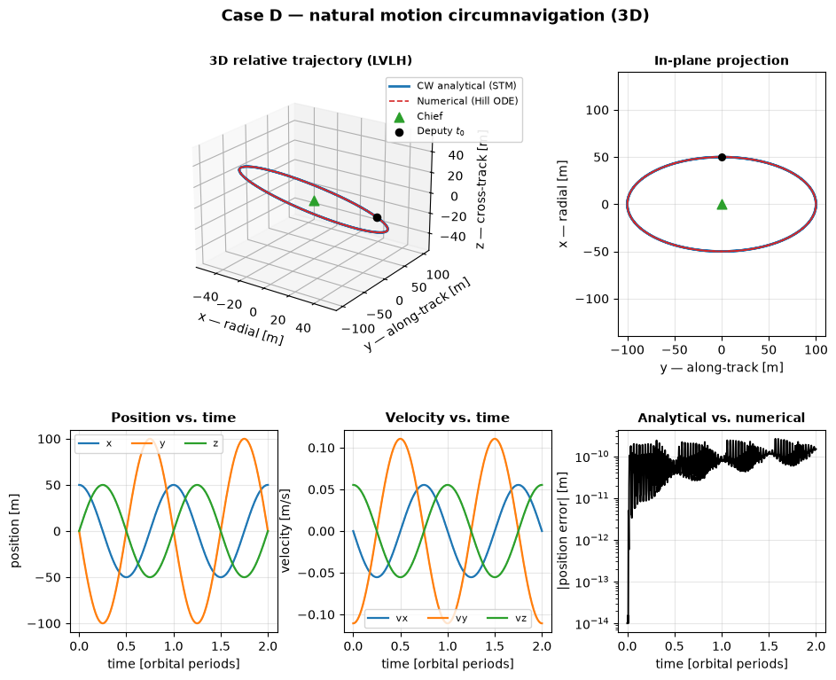

*A drift-free, out-of-plane relative orbit (natural motion circumnavigation) around the chief, from [`examples/01_cw_fundamentals/cw_fundamentals.ipynb`](examples/01_cw_fundamentals/cw_fundamentals.ipynb): the closed-form Clohessy-Wiltshire solution and the numerical integration of the Hill equations agree down to numerical noise.*

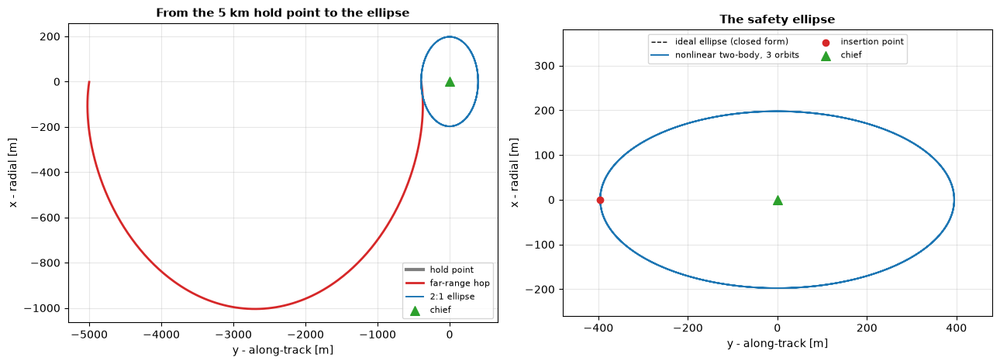

*The far-range approach from a 5 km hold point onto a 2:1 safety ellipse, from [`examples/03_rendezvous_to_safety_ellipse/rendezvous_to_safety_ellipse.ipynb`](examples/03_rendezvous_to_safety_ellipse/rendezvous_to_safety_ellipse.ipynb): flown with nonlinear two-body dynamics, closing within a few metres of the design.*

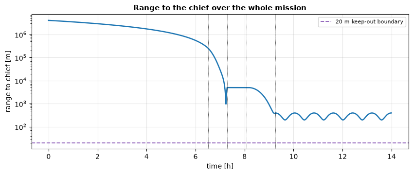

*Range to the chief over the whole rendezvous mission, checked against a keep-out zone in [`examples/05_rendezvous_safety_assessment/rendezvous_safety_assessment.ipynb`](examples/05_rendezvous_safety_assessment/rendezvous_safety_assessment.ipynb): deterministic margin, passive safety, approach corridor, J2 station-keeping and a Monte Carlo collision probability all run on the same flown trajectory.*

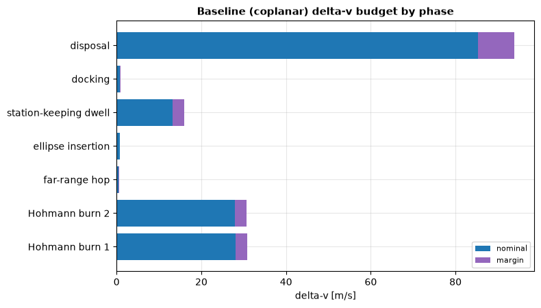

*The full mission, phasing through disposal, as a delta-v budget in [`examples/08_mission_budget/mission_budget.ipynb`](examples/08_mission_budget/mission_budget.ipynb): every phase margined by how mature its design is, converted to propellant mass through the rocket equation, and checked against a low-thrust alternative.*

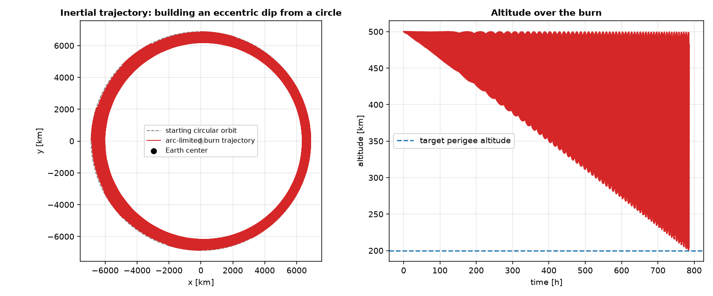

*The deorbit burn from `mission_budget.ipynb`, re-flown with thrust confined to a narrow arc of each orbit instead of running continuously, in [`examples/09_low_thrust_arc_optimization/low_thrust_arc_optimization.ipynb`](examples/09_low_thrust_arc_optimization/low_thrust_arc_optimization.ipynb): the same propellant mass, now actually driving perigee down to the target altitude instead of just spreading the same delta-v evenly into a near-circular spiral.*

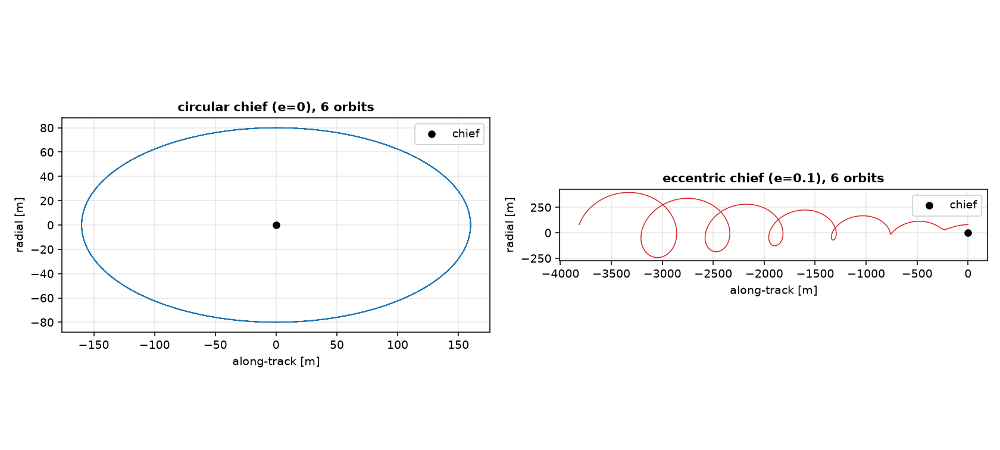

*A relative orbit designed drift-free against a circular chief, in [`examples/02_eccentric_chief_relative_motion/eccentric_chief_relative_motion.ipynb`](examples/02_eccentric_chief_relative_motion/eccentric_chief_relative_motion.ipynb): the identical design flown against a mildly eccentric chief instead, with `eccentric_hill_equations_symbolic`, visibly fails to close over the same six orbits.*

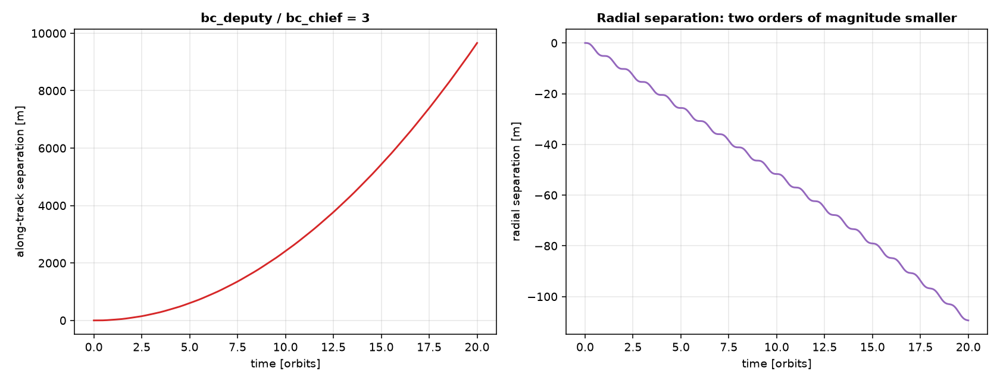

*Two spacecraft started on the identical orbit, differing only in ballistic coefficient, in [`examples/07_differential_drag/differential_drag.ipynb`](examples/07_differential_drag/differential_drag.ipynb): the same kind of along-track drift as a low-thrust burn or a relative orbit elements mismatch, driven here by atmospheric drag alone, with no propellant spent.*

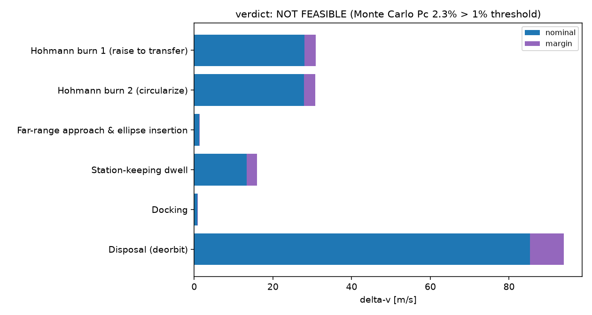

*An automated feasibility verdict from a YAML mission scenario, in [`examples/12_mission_feasibility_report/mission_feasibility_report.ipynb`](examples/12_mission_feasibility_report/mission_feasibility_report.ipynb): every deterministic safety and budget check passes, but the Monte Carlo collision probability does not, the same risk `examples/05_rendezvous_safety_assessment.ipynb` found by hand, now caught automatically.*

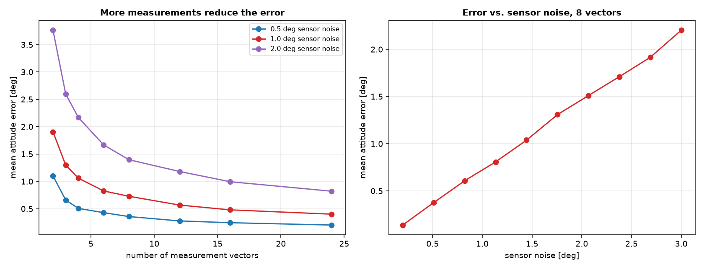

*TRIAD and a singular-value-decomposition solution to Wahba's problem, in [`examples/13_attitude_determination/attitude_determination.ipynb`](examples/13_attitude_determination/attitude_determination.ipynb): exact recovery of a known attitude with no noise, and the expected least-squares scaling once sensor noise is added.*

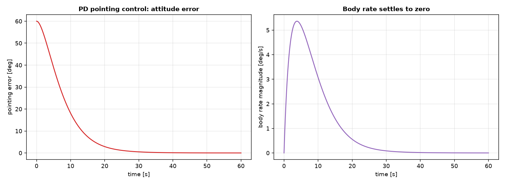

*A rigid body attitude controller in [`examples/11_attitude_pointing_control/attitude_pointing_control.ipynb`](examples/11_attitude_pointing_control/attitude_pointing_control.ipynb): quaternion kinematics and Euler's rotational equations, validated by energy and angular momentum conservation, driven by a PD law that settles a 60 degree pointing error to a fraction of a degree.*

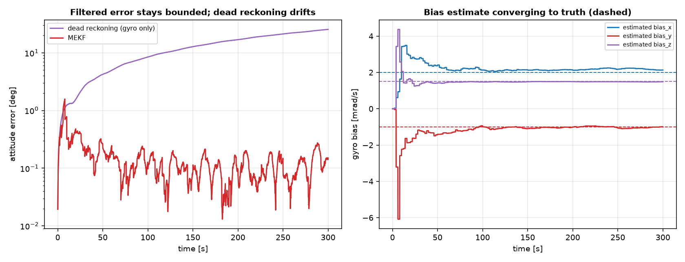

*A multiplicative extended Kalman filter (MEKF) in [`examples/14_attitude_estimation_filter/attitude_estimation_filter.ipynb`](examples/14_attitude_estimation_filter/attitude_estimation_filter.ipynb): combining the rigid body dynamics with the vector-measurement attitude solutions above into one recursive estimator, which tracks attitude to a fraction of a degree and learns the gyro's own bias, while an uncorrected gyro-only integration drifts to tens of degrees over the same run.*

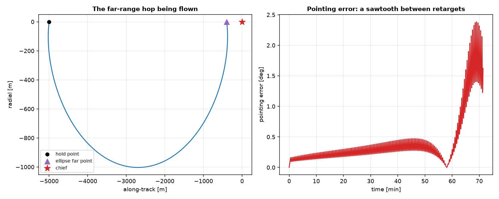

*Attitude tied to actual relative motion for the first time, in [`examples/15_attitude_coupled_pointing/attitude_coupled_pointing.ipynb`](examples/15_attitude_coupled_pointing/attitude_coupled_pointing.ipynb): a body axis tracks the chief through the same far-range hop flown elsewhere in this project, re-pointing periodically rather than chasing one fixed target, with the pointing error growing fastest right as the deputy closes in.*

## Installation

Requires [conda](https://conda.io) (e.g. [Miniforge](https://github.com/conda-forge/miniforge)). The dynamics modules depend on [heyoka.py](https://github.com/bluescarni/heyoka.py), which ships prebuilt binaries only through conda-forge (no Windows pip wheels), so this project is conda-first rather than pip/venv-based.

```bash
git clone https://github.com/giovannifacchinetti99/ios-mission-planner.git
cd ios-mission-planner

conda env create -f environment.yml
conda activate ios-mission-planner
```

`environment.yml` installs Python, heyoka.py, numpy, matplotlib, Jupyter, [pygmo](https://esa.github.io/pygmo2/) (ESA's optimization library, used for the low-thrust arc-width trade-off), PyYAML, Jinja2 and [WeasyPrint](https://weasyprint.org/) (used to generate the mission feasibility reports), and the package itself in editable mode (via `pip install -e .` under the hood), so changes to `src/` are picked up immediately without reinstalling.

To run the example notebooks from this environment's Jupyter kernel:

```bash
python -m ipykernel install --user --name ios-mission-planner --display-name "Python (ios-mission-planner)"
```

The notebooks under `examples/` are numbered `01_...` through `15_...` by
how far along the project they build on: start from `01_cw_fundamentals`
and work upward for the intended reading order, which also matches the
[documentation book](https://giovannifacchinetti99.github.io/ios-mission-planner/)'s
own structure.

## Testing

```bash
pytest
```

The suite under `tests/` covers every module in `src/`: conservation laws and round-trips for the dynamics, margin and rocket-equation sanity checks for the budget, and sign-convention checks for the safety tools.

## Usage

Relative motion (HCW), numerically integrated:

```python
import numpy as np
from ios_mission_planner.dynamics.relative.hill import hill_equations_symbolic
from ios_mission_planner.propagation.heyoka_propagator import propagate

n = 0.0011  # mean motion [rad/s]
state0 = np.array([100.0, 0.0, 0.0, 0.0, 0.0, 0.0])
t_eval = np.linspace(0, 5400, 200)

solution = propagate(hill_equations_symbolic(), state0, t_eval, pars=[n])
```

Absolute (inertial) two-body motion, numerically integrated:

```python
import numpy as np
from ios_mission_planner.constants import MU_EARTH
from ios_mission_planner.dynamics.orbital.two_body import two_body_dynamics_symbolic
from ios_mission_planner.propagation.heyoka_propagator import propagate

state0 = np.array([6878.137, 0.0, 0.0, 0.0, 7.6126, 0.0])  # km, km/s
t_eval = np.linspace(0, 5677, 200)

solution = propagate(two_body_dynamics_symbolic(), state0, t_eval, pars=[MU_EARTH])
```

Two-impulse targeting from a hold point at y = -1000 m to one at y = -200 m, in 0.75 orbits:

```python
import numpy as np
from ios_mission_planner.dynamics.relative.cw import cw_targeting

n = 0.0011  # mean motion [rad/s]
T = 2 * np.pi / n

dv1, dv2 = cw_targeting(
    r0=[0.0, -1000.0, 0.0], v0=[0.0, 0.0, 0.0],
    rf=[0.0, -200.0, 0.0], vf=[0.0, 0.0, 0.0],
    t=0.75 * T, n=n,
)
```

Checking a relative trajectory against a keep-out zone:

```python
import numpy as np
from ios_mission_planner.safety.keepout import KeepOutEllipsoid, check_trajectory

zone = KeepOutEllipsoid(a=20.0, b=20.0, c=20.0)  # metres, chief-centred
positions = np.array([[100.0, 0.0, 0.0], [15.0, 0.0, 0.0]])  # relative positions over time

violated, margin, mask = check_trajectory(positions, zone)
```

A margined delta-v budget, converted to propellant mass through the rocket equation:

```python
from ios_mission_planner.budget.margins import BudgetLine, MATURITY_MARGIN, total_delta_v
from ios_mission_planner.budget.propellant import initial_mass

lines = [
    BudgetLine("phasing burn", 55.9, MATURITY_MARGIN["analyzed"]),
    BudgetLine("station-keeping dwell", 13.3, MATURITY_MARGIN["preliminary"]),
]
dv_total = total_delta_v(lines, system_margin=0.10)  # + a 10% mission reserve

propellant_kg = initial_mass(dv_total, isp=220.0, m_dry=150.0) - 150.0
```

A full mission feasibility report, from a declarative YAML scenario (dynamics, safety, and budget run automatically):

```python
from ios_mission_planner.report.scenario import load_scenario
from ios_mission_planner.report.pipeline import run_feasibility_analysis
from ios_mission_planner.report.render import render_html, render_pdf

scenario = load_scenario("my_mission.yaml")
result = run_feasibility_analysis(scenario)

print(result.verdict)  # "FEASIBLE" / "FEASIBLE WITH CAVEATS" / "NOT FEASIBLE"

html = render_html(result)
render_pdf(html, "report.pdf")
```
