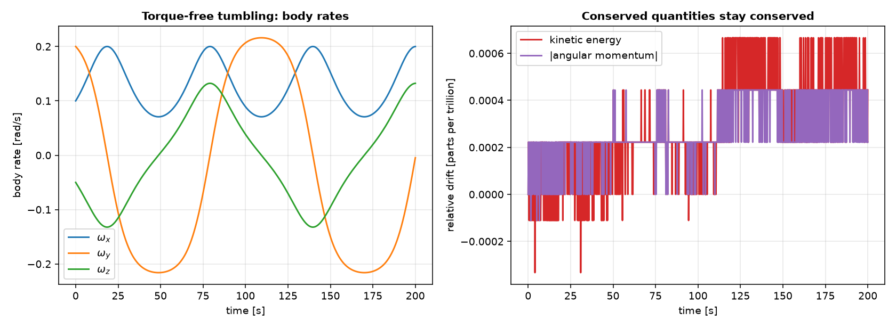
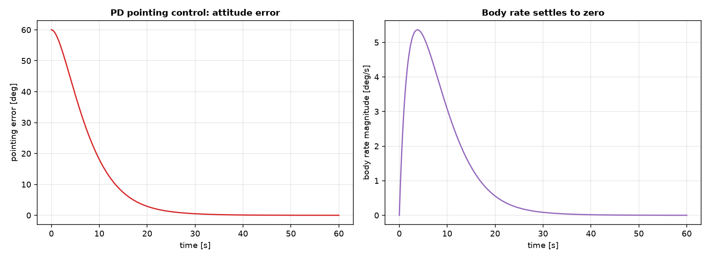
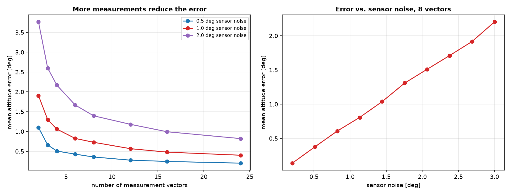
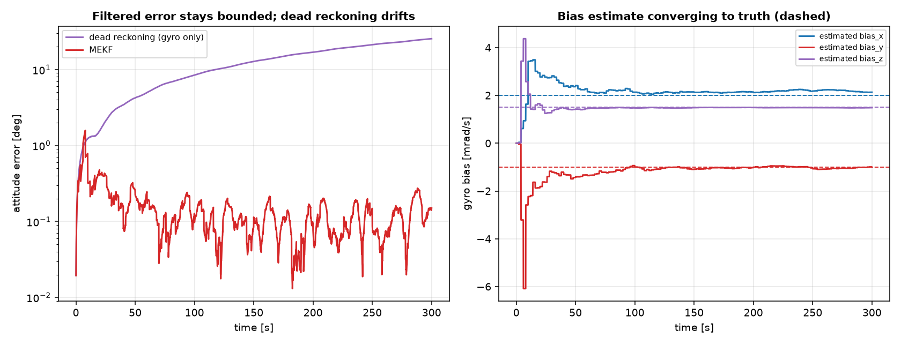
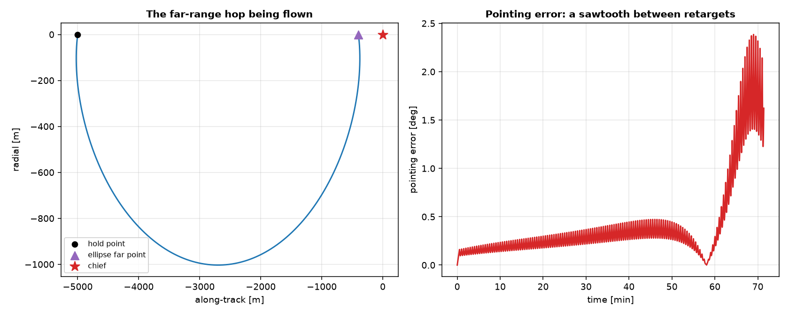
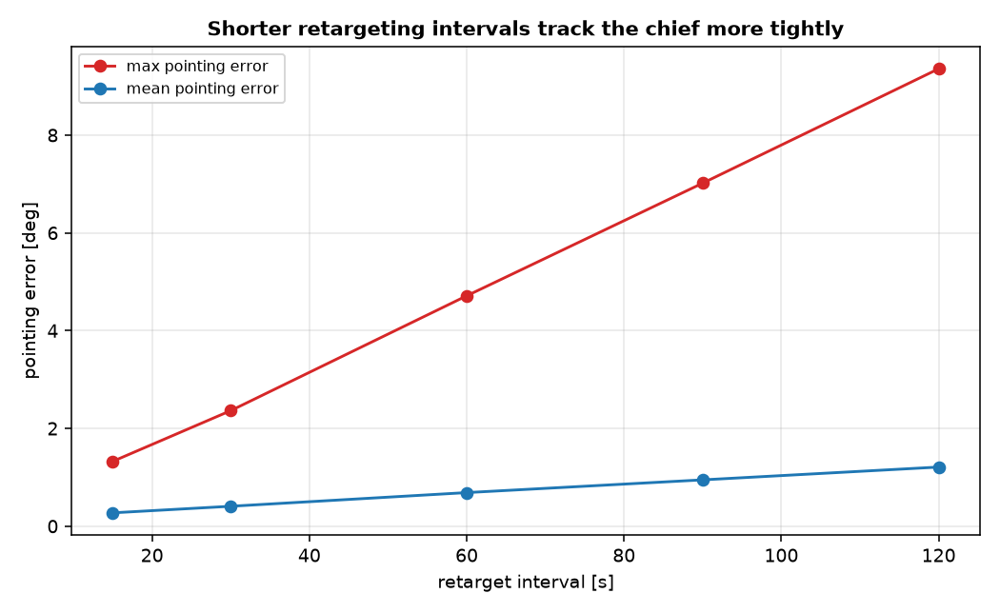

# Attitude dynamics and pointing control

Every other chapter in this book treats a spacecraft as a point mass: its
position and velocity are everything that matters. A real rendezvous and
proximity operation also cares which way the spacecraft is facing, keeping
a sensor, antenna, or docking port pointed where it needs to be while the
translational dynamics built everywhere else in this project fly the
trajectory. This chapter adds the rotational counterpart to that point-mass
dynamics: how a rigid body's orientation evolves, and a simple feedback law
that points it at a target.

## Representing orientation: quaternions

Code: {py:func}`quaternion_kinematics_symbolic
<ios_mission_planner.dynamics.attitude.rigid_body.quaternion_kinematics_symbolic>`
in `src/ios_mission_planner/dynamics/attitude/rigid_body.py`.
Reference: Markley, Crassidis, *Fundamentals of Spacecraft Attitude
Determination and Control*.

A rotation from the inertial frame to a body frame can be represented in
several ways: a $3\times3$ rotation matrix, a set of Euler angles, or a
unit quaternion $\vect q = (q_0, q_1, q_2, q_3)$, with $q_0$ the scalar
part (the Hamilton convention used throughout this chapter). Quaternions
avoid the singularities Euler angles have at certain orientations (gimbal
lock) and are cheaper to propagate and renormalize than a full rotation
matrix, which is why they are the standard representation for numerically
integrating attitude. Given the body's angular velocity $\vect\omega$,
expressed in the body frame, the quaternion evolves by

$$
\dot{\vect q} = \frac12\,\vect q \otimes \vect\omega,
$$

treating $\vect\omega$ as the pure quaternion $(0,\omega_x,\omega_y,
\omega_z)$ and $\otimes$ as the Hamilton product. Expanded into components,
this is exactly what `quaternion_kinematics_symbolic` returns:

$$
\dot q_0 = -\tfrac12(q_1\omega_x+q_2\omega_y+q_3\omega_z), \qquad
\dot q_1 = \tfrac12(q_0\omega_x+q_2\omega_z-q_3\omega_y),
$$

$$
\dot q_2 = \tfrac12(q_0\omega_y-q_1\omega_z+q_3\omega_x), \qquad
\dot q_3 = \tfrac12(q_0\omega_z+q_1\omega_y-q_2\omega_x).
$$

A quaternion that starts with unit norm stays at unit norm under this
equation exactly, in continuous time; what the validation below actually
checks is that the numerical integration preserves that property too.

## Euler's rotational equations

Code: {py:func}`euler_rotational_equations_symbolic
<ios_mission_planner.dynamics.attitude.rigid_body.euler_rotational_equations_symbolic>`,
{py:func}`rigid_body_attitude_dynamics_symbolic
<ios_mission_planner.dynamics.attitude.rigid_body.rigid_body_attitude_dynamics_symbolic>`
in `src/ios_mission_planner/dynamics/attitude/rigid_body.py`.

Quaternion kinematics says how orientation changes given the angular
velocity; Euler's rotational equations say how the angular velocity itself
changes under an applied torque. For a rigid body on its principal axes,
with diagonal inertia tensor $\mathrm{diag}(I_x,I_y,I_z)$ in the body
frame,

$$
I_x\dot\omega_x = (I_y-I_z)\,\omega_y\omega_z + \tau_x, \qquad
I_y\dot\omega_y = (I_z-I_x)\,\omega_z\omega_x + \tau_y, \qquad
I_z\dot\omega_z = (I_x-I_y)\,\omega_x\omega_y + \tau_z.
$$

The cross terms are the gyroscopic coupling between axes: unless the body
is symmetric about two of its principal axes ($I_x=I_y$, say), rotation
about one axis feeds into the others, which is exactly why a tumbling body
with three distinct principal moments does not simply spin about a fixed
axis. `rigid_body_attitude_dynamics_symbolic` couples this to the
quaternion kinematics above into one seven-state system, with the torque
supplied as a runtime parameter; setting it to zero gives torque-free
motion, the case with the cleanest validation available, since both the
rotational kinetic energy $\tfrac12\vect\omega\cdot\mathbf I\vect\omega$
and the magnitude of the angular momentum $\mathbf I\vect\omega$ are
exactly conserved with no torque applied, the rotational analogue of the
two-body energy and angular momentum checks from the absolute dynamics
chapter.

## Pointing control

Code: {py:func}`pd_pointing_attitude_dynamics_symbolic
<ios_mission_planner.dynamics.attitude.rigid_body.pd_pointing_attitude_dynamics_symbolic>`
in `src/ios_mission_planner/dynamics/attitude/rigid_body.py`.

Keeping a docking port or sensor pointed at a target needs feedback: a
torque that pushes the attitude error toward zero and damps out the
angular velocity as it gets there, the same proportional-derivative
structure used informally everywhere else a `kp`/`kd` pair shows up. The
attitude error between the current orientation $\vect q$ and a fixed
target $\vect q_t$ is itself a quaternion, $\vect q_e =
\mathrm{conj}(\vect q_t)\otimes\vect q$, whose vector part
$(q_{e1},q_{e2},q_{e3})$ is zero exactly when the body is at the target
attitude (and whose scalar part $q_{e0}\to\pm1$ there). The control torque

$$
\vect\tau = -k_p\,(q_{e1},q_{e2},q_{e3}) - k_d\,\vect\omega
$$

drives that vector part, and the body rate alongside it, toward zero.
`pd_pointing_attitude_dynamics_symbolic` builds this directly into the
symbolic system, the same way the low-thrust chapter's arc gate builds a
smooth on/off switch into its own dynamics, rather than computing a torque
externally and feeding it back in at every step.

This control law is deliberately the simple version. A real implementation
would flip the sign of the proportional term based on the sign of $q_{e0}$
to always take the shorter of the two rotations between the current and
target attitude; without that correction, a starting attitude on the "far
side" ($q_{e0}$ near $-1$) can settle the long way around instead, a known
issue called unwinding that this chapter's controller does not correct
for.

## Attitude determination from vector measurements

Code: {py:func}`quaternion_to_rotation_matrix
<ios_mission_planner.dynamics.attitude.determination.quaternion_to_rotation_matrix>`,
{py:func}`rotation_matrix_to_quaternion
<ios_mission_planner.dynamics.attitude.determination.rotation_matrix_to_quaternion>`,
{py:func}`triad_attitude
<ios_mission_planner.dynamics.attitude.determination.triad_attitude>`,
{py:func}`wahba_svd_attitude
<ios_mission_planner.dynamics.attitude.determination.wahba_svd_attitude>`
in `src/ios_mission_planner/dynamics/attitude/determination.py`.
Reference: Wahba, "A Least Squares Estimate of Satellite Attitude," *SIAM
Review*, 7(3), 1965; Markley, Crassidis, *Fundamentals of Spacecraft
Attitude Determination and Control*.

The dynamics and the controller above both assume the current attitude is
simply known. A real spacecraft has to determine it first, from sensors
that each measure a single direction, a sun sensor, a magnetometer, a star
tracker, not the attitude itself. Given one such measurement in the body
frame, $\vect b$, and the same direction as known in the reference frame,
$\vect r$, a single vector pair is not enough to fix an orientation: it
constrains two of the three rotational degrees of freedom, leaving a free
rotation about $\vect b$ itself undetermined. A second, non-parallel
vector pair fixes that remaining freedom, which is exactly what the
classical **TRIAD** method uses: it builds an orthonormal triad from
$(\vect b_1,\vect b_2)$ the same way from $(\vect r_1,\vect r_2)$, and
returns the rotation that maps one triad onto the other, trusting the
first vector of each pair exactly and using the second only to fix the
plane.

With more than two measurements available, discarding all but two throws
away real information. The more general question, finding the rotation
$R$ minimizing the weighted sum of squared errors
$\sum_i w_i\,|\vect b_i - R\vect r_i|^2$ over any number of vector pairs,
is Wahba's problem (1965), and it is also exactly the problem the famous
QUEST algorithm was built to solve. `wahba_svd_attitude` solves the same
problem by a different, numerically simpler route: forming the attitude
profile matrix $B=\sum_i w_i\,\vect b_i\vect r_i^{\mathsf T}$ and taking
its singular value decomposition $B=U\Sigma V^{\mathsf T}$, the optimal
rotation is $R = U\,\mathrm{diag}(1,1,\det U\det V)\,V^{\mathsf T}$, with
no need for QUEST's quaternion eigenvalue iteration, a shortcut that
mattered when a full eigendecomposition was too expensive to compute
on board, not a real consideration today. `rotation_matrix_to_quaternion`
converts the result (by Shepperd's method, picking whichever of four
equivalent formulas stays best-conditioned for the given rotation) into
the same quaternion convention `rigid_body.py` already uses, so an
estimated attitude from here feeds directly into the pointing controller
above.

## A recursive filter: closing the loop

Code: {py:class}`MEKFState
<ios_mission_planner.dynamics.attitude.filter.MEKFState>`,
{py:func}`mekf_predict
<ios_mission_planner.dynamics.attitude.filter.mekf_predict>`,
{py:func}`mekf_update
<ios_mission_planner.dynamics.attitude.filter.mekf_update>` in
`src/ios_mission_planner/dynamics/attitude/filter.py`.
Reference: Lefferts, Markley, Shuster, "Kalman Filtering for Spacecraft
Attitude Estimation," *Journal of Guidance, Control, and Dynamics*, 5(5),
1982; Markley, Crassidis, *Fundamentals of Spacecraft Attitude
Determination and Control*.

TRIAD and the SVD solution above both solve attitude from scratch, at a
single instant, from whatever measurements are available right then. A
gyro gives something those methods do not use at all: a continuous
estimate of the rate itself, between measurements, carrying its own
(generally unknown, slowly varying) bias. The multiplicative extended
Kalman filter (MEKF) combines the two: it propagates attitude
continuously from the gyro, using exactly the quaternion kinematics
already derived above, and corrects both the attitude and the estimated
gyro bias whenever a new vector measurement arrives.

The "multiplicative" part is what keeps this well-posed. A quaternion
carries a unit-norm constraint, so a plain additive covariance on all
four components would be singular; the MEKF instead keeps a minimal,
unconstrained three-parameter attitude *error* in its covariance,
$\delta\vect\theta$, defined through $\vect q = \hat{\vect q}\otimes
\delta\vect q(\delta\vect\theta)$, alongside a three-parameter gyro bias
error, and only ever folds the corrected error back into the quaternion
estimate itself (`mekf_update`'s reset step) rather than ever propagating
or storing it directly. Between measurements, `mekf_predict` advances
$\hat{\vect q}$ with the exact closed-form quaternion update for a
constant rate over the step (the bias-corrected gyro reading), and
advances the 6x6 error covariance with the standard linearized error
dynamics,

$$
\delta\dot{\vect\theta} = -\hat{\vect\omega}\times\delta\vect\theta -
\delta\vect b, \qquad \delta\dot{\vect b} = \vect\eta_b,
$$

the first term the same gyroscopic coupling Euler's equations already
show, the second the gyro bias leaking directly into attitude error, and
the third a random-walk model for how the bias itself might drift. At
each measurement, `mekf_update` takes an attitude solution (from
`triad_attitude` or `wahba_svd_attitude`, converted to a quaternion with
`rotation_matrix_to_quaternion`), forms the small-angle error between it
and the current estimate, and applies the ordinary Kalman gain and
covariance update to correct both $\hat{\vect q}$ and the bias estimate
together, since the two are coupled through exactly the process model
above.

Validated against a gyro with a constant, injected bias unknown to both
estimators: an uncorrected "dead reckoning" propagation (gyro integration
alone, exactly `mekf_predict` with no update ever applied) drifts to tens
of degrees of error within minutes, while the filtered estimate stays
within a fraction of a degree throughout, and the bias estimate itself
visibly converges toward the true injected value on all three axes.

## Coupling to a real relative trajectory

Code: {py:func}`target_quaternion_toward_chief
<ios_mission_planner.dynamics.attitude.target_pointing.target_quaternion_toward_chief>`,
{py:func}`fly_with_periodic_retargeting
<ios_mission_planner.dynamics.attitude.target_pointing.fly_with_periodic_retargeting>`,
{py:func}`boresight_pointing_error_deg
<ios_mission_planner.dynamics.attitude.target_pointing.boresight_pointing_error_deg>`
in `src/ios_mission_planner/dynamics/attitude/target_pointing.py`.

Everything above points at a fixed target, chosen once. A real approach
needs a body axis pointed at the chief continuously, as the relative
geometry itself evolves along whatever trajectory the relative dynamics
chapter designs. Fixing where a body axis should point is the same
two-vector problem `triad_attitude` already solves for attitude
*determination*, read in the opposite direction: pointing a primary body
axis along $-\hat{\vect\rho}$ (toward the chief) and a secondary axis
along a fixed reference (the LVLH cross-track direction, by default) is
exactly the TRIAD construction, with the body axes playing the role the
measured directions played before. `target_quaternion_toward_chief` reuses
it unchanged for this purpose, treating the chief's LVLH frame as if it
were the inertial frame the rest of this chapter's dynamics use, a stated
simplification: LVLH does rotate, at the orbital rate, far slower than any
attitude control bandwidth in this chapter, and folding that rotation into
a true inertial composition would add bookkeeping this module keeps out.

`fly_with_periodic_retargeting` flies the relative motion (the linear Hill
equations from the relative dynamics chapter) and the attitude together,
recomputing the target from the deputy's actual position only every
`retarget_interval` seconds and holding it fixed in between, a periodic
guidance update rather than a continuously recomputed closed form, chosen
specifically to avoid embedding Shepperd's method's branching logic inside
a single symbolic ODE system.

Flown on the same far-range hop built in the relative dynamics chapter,
the pointing error traces a sawtooth, growing between retargets and
resetting at each update, with a telling detail: the sawtooth grows
noticeably larger in the final few minutes, as the deputy closes in on the
chief. The direction to a nearby object sweeps through a wider angle per
unit time than a distant one does, for the same reason a nearby lamppost
seems to swing past faster than a distant one while walking, so a fixed
retargeting cadence falls further behind exactly during the closing phase
of an approach, when it matters most.

`boresight_pointing_error_deg` is the piece worth distinguishing from the
safety chapter's approach corridor specifically: the corridor checks
whether the trajectory's *geometry* stays within an allowed cone, with no
reference to attitude at all, while this checks whether a sensor would
actually have the chief in view given the attitude the controller really
achieves, a genuinely different question that only this coupled model can
answer.

## What this chapter does not build

This coupling stays deliberately bounded. The relative dynamics used here
are still the linearized, circular-chief Hill equations, not the
eccentric-chief or J2-aware models built elsewhere in this project, and
nothing feeds a pointing requirement back into how a trajectory itself is
designed, only checks how well a fixed trajectory's attitude requirement
is met after the fact. There is also still no plume impingement model, and
the vector measurements driving both the determination and the filter
sections are synthetic throughout, generated directly from a known true
attitude plus injected noise, not from any model of a specific real
sensor's actual error characteristics. Feeding pointing requirements back
into trajectory design, and modeling real sensor hardware in enough detail
to replace these synthetic measurements, remain future work this chapter
does not attempt.

## See it in action

The worked examples for this chapter are
{doc}`../examples/11_attitude_pointing_control/attitude_pointing_control`,
which runs the torque-free validation and the pointing control scenario
above; {doc}`../examples/13_attitude_determination/attitude_determination`,
which validates TRIAD and the SVD solution to Wahba's problem against a
known attitude and shows how the estimation error scales with the number
of measurements and the sensor noise; and
{doc}`../examples/14_attitude_estimation_filter/attitude_estimation_filter`,
which runs the MEKF against dead reckoning on a simulated gyro with an
unknown bias; and
{doc}`../examples/15_attitude_coupled_pointing/attitude_coupled_pointing`,
which flies the attitude and relative dynamics together on a real
far-range hop and sweeps how the retargeting cadence affects pointing
error.
