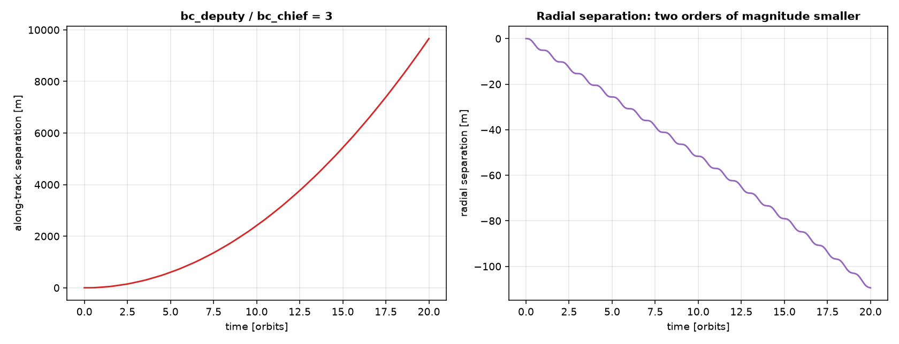
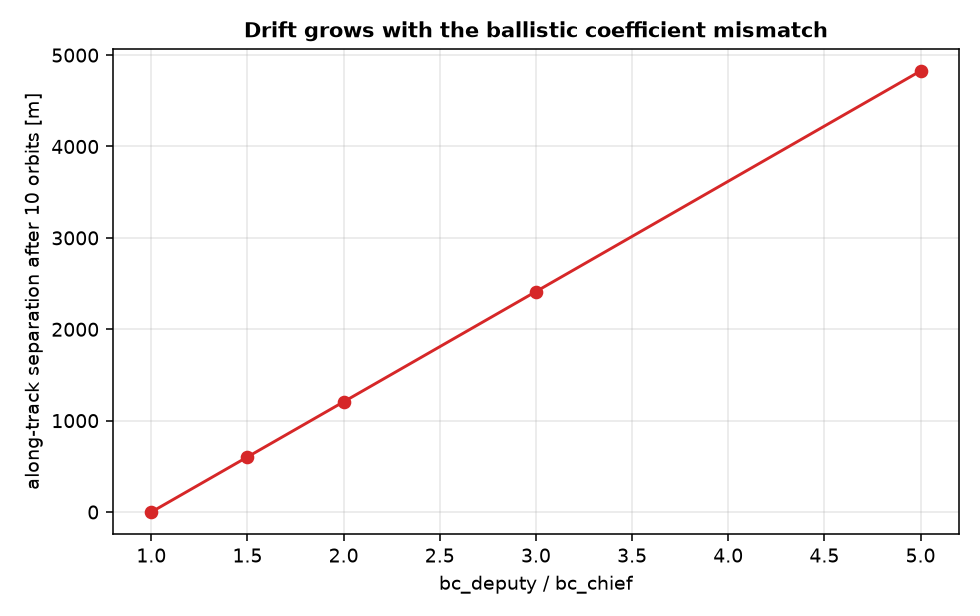

# Atmospheric drag and differential drag

The absolute dynamics chapter covers the two dominant effects on a
low-Earth orbit: the two-body attraction and the J2 oblateness correction.
At the altitudes this project works at, a third effect is not negligible
either: atmospheric drag, the one perturbation here that removes energy
from the orbit rather than just redistributing it. This section adds a
drag model to the dynamics, and then turns it into something useful:
differential drag, a way to control the along-track separation between two
spacecraft without spending any propellant at all.

## An exponential atmosphere and the drag acceleration

Code: {py:func}`exponential_atmosphere_density
<ios_mission_planner.dynamics.orbital.drag.exponential_atmosphere_density>`,
{py:func}`drag_acceleration_symbolic
<ios_mission_planner.dynamics.orbital.drag.drag_acceleration_symbolic>`,
{py:func}`two_body_drag_dynamics_symbolic
<ios_mission_planner.dynamics.orbital.drag.two_body_drag_dynamics_symbolic>`,
{py:func}`two_body_j2_drag_dynamics_symbolic
<ios_mission_planner.dynamics.orbital.drag.two_body_j2_drag_dynamics_symbolic>`
in `src/ios_mission_planner/dynamics/orbital/drag.py`.
Reference: Vallado, *Fundamentals of Astrodynamics and Applications*.

The simplest useful model of how atmospheric density falls off with
altitude is a single exponential band, a reference density at a reference
radius decaying with a characteristic scale height:

$$
\rho(r) = \rho_0 \, e^{-(r - r_0)/H}.
$$

Real density depends on solar activity, local time, and latitude well
beyond what one exponential band captures; this is the model good enough to
size the effect and study its qualitative behavior, not to forecast density
precisely. `exponential_atmosphere_density` implements exactly this
formula, parametrized so the caller supplies $\rho_0$, $r_0$, and $H$
directly rather than this project asserting a specific table of "the"
correct values for a given altitude band.

Drag itself opposes the spacecraft's velocity relative to the atmosphere,
not its velocity relative to the inertial frame: the atmosphere corotates
with the Earth, so the relevant relative velocity is $\vect v_{\mathrm{rel}}
= \vect v - \vect\omega_\oplus \times \vect r$, with $\vect\omega_\oplus$
along the Earth's rotation axis. The acceleration itself is

$$
\vect a_{\mathrm{drag}} = -\frac12\,\rho\,\frac{C_d A}{m}\,
|\vect v_{\mathrm{rel}}|\,\vect v_{\mathrm{rel}},
$$

the standard quadratic-drag form, with the object's own properties
collapsed into a single ballistic coefficient $C_d A/m$: drag coefficient
times cross-sectional area over mass. A larger ballistic coefficient means
more drag for the same density and speed, which is exactly the lever
differential drag pulls on below. `drag_acceleration_symbolic` implements
this directly, and `two_body_drag_dynamics_symbolic` /
`two_body_j2_drag_dynamics_symbolic` add it to the two-body (optionally
plus J2) equations of motion from the absolute dynamics chapter, the same
way `perturbations.py` already adds J2 to plain two-body motion.

Checked against plain two-body motion, a circular orbit propagated under
this model behaves exactly as expected: its semi-major axis shrinks
monotonically, faster for a larger ballistic coefficient, with no need for
anything beyond conservation of energy and the sign of the drag force to
predict the direction of that trend.

## Differential drag: the same $\delta a$ drift, for free

Two spacecraft on the identical orbit, differing only in ballistic
coefficient, decay at different rates: the one with more drag drops to a
slightly lower, slightly faster orbit and pulls steadily ahead
along-track. This is the same $\delta a$-driven secular along-track drift
already seen twice elsewhere in this project, in the relative orbit
elements chapter's $\delta a$ term and in the budget chapter's continuous
low-thrust spiral, produced here by nothing but a difference in
cross-section rather than by any thruster. The radial separation stays two
orders of magnitude smaller throughout, since both orbits remain close to
circular and nearly coplanar: differential drag is fundamentally an
along-track effect, not a way to open up separation in the other two axes.

The size of the effect scales directly with how different the two
ballistic coefficients actually are, which is exactly how real missions use
it operationally: by changing attitude to present a different
cross-section, rather than by carrying different hardware, two otherwise
identical spacecraft can be made to drift apart, or brought back together,
without spending propellant. What this project's model does not build is
that control loop itself: both ballistic coefficients are held fixed
throughout, so the two objects only ever drift apart. A real controller
switches which object carries the higher drag over time to converge on a
target separation instead, which needs nothing new physically, the same
ballistic coefficient already modeled here, just varied on a schedule, but
is a genuine control-design problem this project leaves open.

## See it in action

The worked example for this chapter is
{doc}`../examples/differential_drag`, which validates the single-orbit
decay, builds the along-track drift between two ballistic coefficients
from scratch, and sweeps how the drift rate scales with the mismatch
between them.
