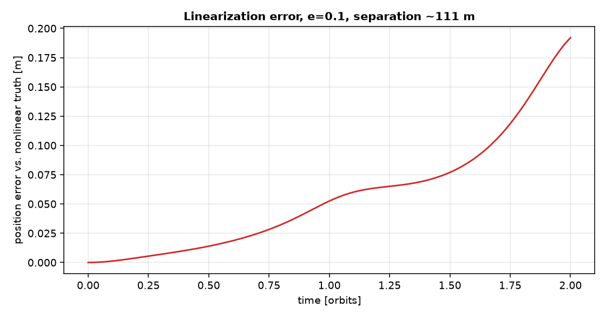
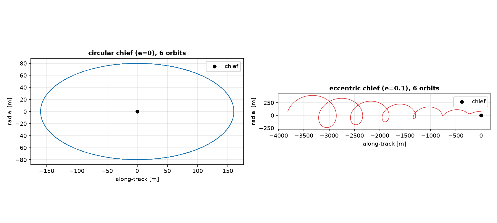

# Relative motion about an eccentric chief

The relative dynamics chapter built everything on Hill-Clohessy-Wiltshire,
which assumes a circular chief. This section drops that assumption,
extending the same kind of linearized relative motion to a chief on an
unperturbed Keplerian orbit of any eccentricity.

## Why the circular assumption mattered

Recall from the relative dynamics chapter that the HCW equations come from
two simplifications: the chief is circular, so its angular rate $n$ is
constant, and the deputy stays close enough to the chief that the
difference in gravitational acceleration between the two can be linearized
in the separation $\vect\rho$. Dropping only the first of these, keeping the
second, is enough to extend the model to any chief eccentricity: the chief's
angular rate $\dot\theta$ and radius $r_c$ are no longer constant, but they
are still exactly computable from the chief's own two-body motion at every
instant, since nothing about the chief's own orbit changed.

## The linearized equations for a general chief

Code: {py:func}`eccentric_hill_equations_symbolic
<ios_mission_planner.dynamics.relative.eccentric_hill.eccentric_hill_equations_symbolic>`
in `src/ios_mission_planner/dynamics/relative/eccentric_hill.py`.
Reference: *Analytical Mechanics of Space Systems*, Fourth Edition.

Working in the same LVLH frame as before ($\hat x$ radial, $\hat y$
along-track, $\hat z$ cross-track), the frame's own angular velocity is
$\vect\omega = \dot\theta\,\hat z$, since an unperturbed chief orbit's plane
does not itself precess: $\hat z$, along the chief's orbit normal, stays
fixed, and all of the frame's rotation is in-plane, described by a single
angle $\theta$ whose rate is set by the chief's own conserved angular
momentum, $\dot\theta = h_c/r_c^2$. Applying the transport theorem twice
(once for velocity, once for acceleration) to the deputy's inertial
acceleration, subtracting the chief's own gravitational acceleration, and
linearizing the gravitational term to first order in $\vect\rho$ exactly as
in the circular derivation, gives

$$
\ddot x = 2\dot\theta\dot y + \ddot\theta y +
\left(\dot\theta^2 + \frac{2\mu}{r_c^3}\right) x, \qquad
\ddot y = -2\dot\theta\dot x - \ddot\theta x +
\left(\dot\theta^2 - \frac{\mu}{r_c^3}\right) y, \qquad
\ddot z = -\frac{\mu}{r_c^3}\,z,
$$

with $\ddot\theta = -2\dot\theta\,\dot r_c/r_c$ (from differentiating
$\dot\theta = h_c/r_c^2$ with $h_c$ constant) and $\dot r_c =
(\vect r_c\cdot\vect v_c)/r_c$. Substituting the circular-orbit values,
$\dot\theta = n$ constant and $\ddot\theta = 0$, these collapse back to
exactly the HCW equations from the relative dynamics chapter; that
substitution is also the cheapest and most direct way to check an
implementation of the general case.

`eccentric_hill_equations_symbolic` implements this by propagating the
chief's own inertial state *alongside* the deputy's relative state in one
coupled heyoka system: $r_c$, $\dot\theta$ and $\ddot\theta$ are built as
symbolic expressions of the chief's instantaneous position and velocity,
the same quantities `two_body_acceleration_symbolic` already needs to
advance the chief's own motion one step further. This keeps the model exact
in the chief's own dynamics (no averaging, no series expansion in
eccentricity) and linearized only in the one place the circular model was
already linearized, the deputy's separation from the chief.

## What this buys, and what it still assumes

Validated against the fully nonlinear truth (propagating chief and deputy
separately with plain two-body dynamics and converting both to the chief's
LVLH frame at every instant), the linearized eccentric model tracks a
close, small relative orbit to a small fraction of a percent of the
separation over several orbits, for a chief of representative eccentricity.
The approximation being tested here is exactly the same one the circular
model already makes, that the deputy stays close enough to the chief for a
first-order expansion in $\vect\rho$ to hold; chief eccentricity on its own
does not make that approximation any worse.

What chief eccentricity does change is more subtle, and shows up even when
the linearization is working perfectly. The relative dynamics chapter's
drift-free design, setting $x_{\mathrm{off}}=0$ so the 2:1 ellipse closes on
itself every orbit, is tuned to a constant angular rate; propagating that
exact same design against an eccentric chief instead, the orbit no longer
closes.

This is the same qualitative symptom the relative orbit elements chapter
found from J2 instead: a relative orbit designed drift-free against one
dynamical model is only as drift-free as that model's own assumptions, and
chief eccentricity is one more assumption worth checking, alongside J2,
before trusting a design to stay put.

## See it in action

The worked example for this chapter is
{doc}`../examples/eccentric_chief_relative_motion`, which runs the
circular-chief reduction check, the nonlinear-truth validation, and the
drift-free design comparison above.
