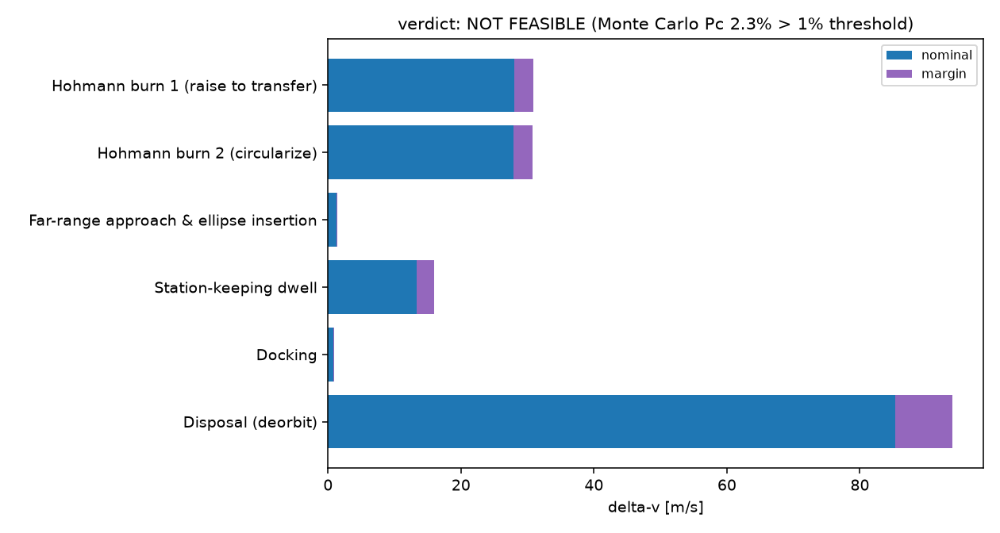

# Automated feasibility reports

Every chapter so far builds and validates one piece of a mission at a
time, with a human wiring the pieces together by hand in a notebook. This
chapter closes the gap that leaves: a pipeline that takes a mission
described declaratively, in a YAML file, and runs it through the dynamics,
safety, and budget layers automatically, producing a single feasibility
verdict and a shareable report. Nothing here is new physics; it is the
orchestration layer this project's roadmap had left completely empty.

## A declarative mission scenario

Code: {py:class}`MissionScenario
<ios_mission_planner.report.scenario.MissionScenario>`,
{py:func}`load_scenario
<ios_mission_planner.report.scenario.load_scenario>` in
`src/ios_mission_planner/report/scenario.py`.

A `MissionScenario` is a plain nested dataclass describing a rendezvous in
the same shape `examples/03_rendezvous_to_safety_ellipse/rendezvous_to_safety_ellipse.ipynb`
through {doc}`../examples/08_mission_budget/mission_budget` build up by
hand: a chief orbit, a deputy's parking orbit and propulsion, a safety
ellipse, a station-keeping dwell, docking, and a disposal burn, plus the
parameters each safety check needs and the thresholds a verdict is checked
against. `load_scenario` reads it from a YAML file, so a new mission is a
text file to edit, not Python code to write. This is deliberately a
template for one mission *shape*, not a general mission designer: a
mission that does not fit this shape, an eccentric chief, a multi-leg
approach, needs either a richer scenario schema or a different pipeline
entirely, not just a different YAML file.

## Orchestrating the earlier layers

Code: {py:func}`run_feasibility_analysis
<ios_mission_planner.report.pipeline.run_feasibility_analysis>` in
`src/ios_mission_planner/report/pipeline.py`.

Given a scenario, the pipeline computes every delta-v from the same
closed-form building blocks validated throughout this project:
`hohmann_transfer` for the phasing and disposal burns, `cw_targeting`
against a `RelativeOrbit` design for the far-range approach and docking,
and the rocket equation for the resulting propellant mass, margined
through `BudgetLine` and `total_delta_v` exactly as in the budget chapter.
It then runs the full safety suite from the safety chapter, keep-out zone,
passive safety, approach corridor, and the Monte Carlo collision
probability, on the resulting trajectory and relative orbit.

This buys speed at a stated cost. {doc}`../examples/08_mission_budget/mission_budget`
flies the mission with full nonlinear two-body dynamics and finds it needs
two separate burns for the far-range approach, a hop and a small
correction, because the nonlinear trajectory does not land exactly where
the linear Clohessy-Wiltshire design predicted. This pipeline works
entirely in the linear model, so that discrepancy does not exist here,
and the two burns collapse into one closed-form targeting solution. That
is an honest simplification, made so a report can be generated in seconds
without a fresh nonlinear propagation for every scenario, and the pipeline
says so explicitly in its output whenever that simplified burn is more
than a token fraction of the total budget, rather than silently absorbing
the difference.

## A verdict built from explicit rules, not a hidden score

The pipeline's verdict, `FEASIBLE`, `FEASIBLE WITH CAVEATS`, or
`NOT FEASIBLE`, comes from a short, fully auditable set of rules: every
deterministic safety check (keep-out, passive safety, corridor) must pass,
the Monte Carlo collision probability must stay under a configured
threshold, and the resulting wet mass must stay under a configured budget.
Any one of those failing is a hard `NOT FEASIBLE`; anything else flagged
along the way (such as the closed-form approximation above) downgrades an
otherwise clean result to `FEASIBLE WITH CAVEATS` rather than hiding it.
There is no weighted score or machine-learned classifier behind this on
purpose: every line of the verdict traces back to one specific number a
reader can check against the threshold next to it, which is what makes the
report something a mission designer can actually audit rather than just
trust.

## Rendering the report

Code: {py:func}`render_html <ios_mission_planner.report.render.render_html>`,
{py:func}`render_pdf <ios_mission_planner.report.render.render_pdf>` in
`src/ios_mission_planner/report/render.py`.

`render_html` fills a Jinja2 template with the `FeasibilityResult`,
embedding its figures as base64-encoded PNGs directly in the page, so the
output is one self-contained HTML file with no separate image assets to
lose track of. `render_pdf` converts that same HTML to a PDF with
[WeasyPrint](https://weasyprint.org/), for whenever a single-file
deliverable to email or print is what is actually needed; both come from
the identical template, so nothing about the report's content depends on
which format it ends up in.

## See it in action

The worked example for this chapter is
{doc}`../examples/12_mission_feasibility_report/mission_feasibility_report`,
which runs the baseline mission from `examples/08_mission_budget` through
this pipeline and finds it flagged `NOT FEASIBLE`, not because of its
propellant budget or any deterministic safety margin, but because its
Monte Carlo collision probability exceeds a 1% threshold, the same risk
`examples/05_rendezvous_safety_assessment` found by hand. A second
scenario, identical except for a tighter relative-navigation assumption,
brings that probability back under threshold and the verdict to
`FEASIBLE`, the kind of sensitivity a real feasibility study needs to
surface, not just a pass or fail on its own.
